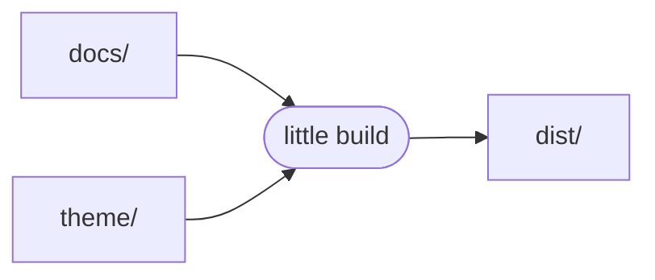

# Getting Started

Three commands, that's the whole CLI so far:

```sh
little serve      # live-reloading dev server at http://127.0.0.1:8080
little build      # write the static site to dist/
little config     # print the site's config, merged
```

## A table, rendered by comrak

| Feature            | Status |
| ------------------ | :----: |
| Markdown + GFM     | ✅     |
| Jupyter notebooks  | ✅     |
| Jekyll-style theme | ✅     |
| Cascading config   | ✅     |
| Live reload        | ✅     |
| Search             | ✅     |
| Plugins (WASM)     | 🔜     |

## A task list

- [x] Install the Rust toolchain
- [x] Render a Markdown page
- [x] Feel the dev loop
- [ ] Decide on little's language 😉

## An alert, as on GitHub

> [!TIP]
> Turn on more of Markdown, like `smart_punctuation`, under `markdown` in
> `little.yml`.

## Math, as MathML

little renders math as it builds the page, so it shows without a script,
like Euler's identity, $e^{i\pi} + 1 = 0$, or the roots of a quadratic:

$$
x = \frac{-b \pm \sqrt{b^2 - 4ac}}{2a}
$$

## Diagrams, as SVG

Write a diagram in Mermaid, as on GitHub, and little draws it as it builds
the page, so it shows without a script too:



## Code, in colour

Name a code block's language after its fence, and little highlights it as it
builds the page, for the theme to colour:

```yaml
# little.yml
markdown:
  math: mathml          # or tex, for a theme's own script, or false
  mermaid: svg          # or false, for a theme's own script
  highlight: pygments   # or github, or false for a theme's own highlighter
```

## Emoji, footnotes, and HTML

GitHub's emoji shortcodes work :tada:, and so do footnotes.[^cascade]

<details>
<summary>And HTML, like this <code>&lt;details&gt;</code></summary>

Its Markdown is rendered too, after a blank line.

</details>

[^cascade]: Like every setting, `markdown` cascades: little sets it, then the
    theme, then the site.
