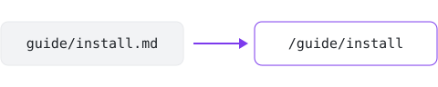

# Install

`little` is a single binary — no runtime, no `node_modules`, no version managers.

## From source

```sh
cargo build --release
./target/release/little serve
```

## Your first page

Create `docs/README.md`, write some Markdown, and run `little serve`.

### Live reload

Save the file and the browser refreshes itself — no manual rebuild.

## Where files go

Pretty URLs mean `docs/guide/install.md` is served at `/guide/install`:



Any other file, like that image, is copied as it is. It's kept beside this page, at
`docs/guide/images/pretty-urls.svg`, and shown with `images/pretty-urls.svg`, relative to
this page's file, as on GitHub. And this page's headings become the "On this page" list to
the right.
