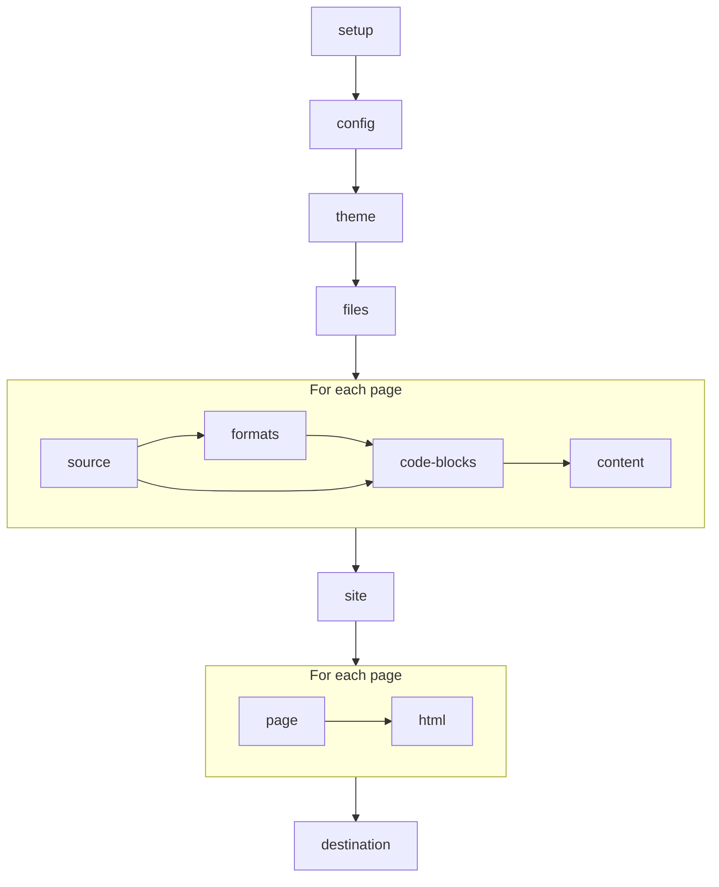

# Plugin hooks

A [plugin](../plugins/using-plugins.md) exports the hooks it needs, from
little's
[`wit/plugin.wit`](https://github.com/withlittle/little/blob/main/wit/plugin.wit),
`little:plugin@0.2.1`. little calls each as the build reaches its step,
with what the build has made so far. What the hook gives back is what the
build goes on with. [Writing plugins](../plugins/writing-plugins.md) shows
how to export one.

## The build, step by step



| Hook | Called | Given | Gives back | If it fails |
| ---- | ------ | ----- | ---------- | ----------- |
| [`setup`](#setup) | as the plugin starts | its settings | nothing | the build stops |
| [`config`](#config) | once | the site's config | the config | the build stops |
| [`theme`](#theme) | once | the theme's files | the files | the build stops |
| [`files`](#files) | once | the paths of the source's files | files to add, and to leave out | the build stops |
| [`source`](#source) | for each page | its file and text | the text | it's warned of, and the text kept |
| [`formats`](#formats) | for each page in its extensions | its file and text | the page's parts | the build stops |
| [`code-blocks`](#code-blocks) | for each block in its languages | the block | Markdown or HTML | it's warned of, and the block kept |
| [`content`](#content) | for each page | its file and HTML | the HTML | it's warned of, and the HTML kept |
| [`site`](#site) | once | `site` | `site` | the build stops |
| [`page`](#page) | for each page | `page` | `page` | it's warned of, and `page` kept |
| [`html`](#html) | for each page | its URL and HTML | the HTML | it's warned of, and the HTML kept |
| [`destination`](#destination) | once | the paths of the site's files | files to add | the build stops |

A hook fails when it gives back an error, or its plugin crashes, as a Rust
plugin does when it panics. One that fails on a page is warned of, naming
the plugin, the hook, and the page. `little build --strict` fails on it:

```text
warning: plugin `links`'s `content` hook failed on ./docs/guide.md: …
```

## Every hook

- little calls each hook of each plugin that exports it, in the order
  `plugins` names them: a theme's first, then the site's. Each gets what
  the one before gave back.
- A build starts each plugin once, so it keeps its state from hook to hook,
  and page to page. It can note each page's title in `page`, say, for a
  file it adds in `destination`.
- After a crash, little starts the plugin again, and calls `setup` before
  the next hook. So what it kept is lost.
- From any hook, a plugin can call `warn`, which it imports, with a line
  for little to warn of. little names the plugin, and `--strict` fails on
  it:

  ```text
  warning: plugin `links`: can't read links/allowed.txt
  ```

- A plugin can read the folders its `read` names, at their paths from the
  site's folder, like `src/app.py`. It can reach nothing else, as
  [the sandbox](../plugins/using-plugins.md#the-sandbox) explains.
- The config, `site`, and `page` are JSON objects, in strings. A file's
  contents are its bytes.

## setup

```wit
setup: func(settings: string) -> result<_, string>;
```

- Called as the plugin starts, before any other hook, with its settings from
  `little.yml`, as a JSON object, like `{"read":["src"],"style":"google"}`.
  They don't have `wasm`, and `read` is always a list.
- An error stops the build, as for a setting the plugin doesn't know.

## config

```wit
config: func(config: string) -> result<string, string>;
```

- Called once, with the site's config, as `little config` prints it: little's,
  the theme's, and the site's, merged.
- Gives back the config the build goes on with. It can change any setting,
  like `markdown`, or add one for the theme, like `announcement`.
- But it can't change `theme`, `plugins`, `source`, `destination`, `host`,
  or `port`, which little reads before plugins start.
- A change to one of those stops the build, as does a config little can't
  use, or an error.

## theme

```wit
record file { path: string, contents: list<u8> }
theme: func(files: list<file>) -> result<list<file>, string>;
```

- Called once, with the files of the site's theme, layered over those of the
  themes it builds on, as the build would use them. Each is in
  `_templates/`, `_static/`, or `_sass/`, by its path, like
  `_templates/default.html`, sorted.
- Gives back the files the site is built with. So it can change a template,
  like adding Open Graph tags to its `<head>`. It can add a stylesheet, or
  leave a file out, too.
- Each file must be in `_templates/`, `_static/`, or `_sass/`, at a path
  as for [`files`](#files). `_templates/default.html` must stay.
- These stop the build:
  - A file outside those folders, or at a path that breaks the rules for
    [`files`](#files).
  - Leaving out `_templates/default.html`.
  - Two files at one path.
  - A file where there's a folder, or in a file.
  - A Sass partial in `_static/`.
  - An error.

## files

```wit
record file { path: string, contents: list<u8> }
record changes { add: list<file>, remove: list<string> }
files: func(paths: list<string>) -> result<changes, string>;
```

- Called once, before any file is read, with the path of each file in the
  source folder, from there, like `guide/install.md`, sorted. It doesn't
  get [hidden](../writing/pages-and-files.md#hidden-files) ones.
- Gives back files to `add`, and the paths of files to `remove`, which are
  left out.
- Each file it adds is built as if it were in the source folder at its
  path. So a Markdown file, or a file a [`formats`](#formats) hook reads,
  is a page, and any other file is copied. That's how an
  [API reference](../plugins/pydoc.md) adds a page for each module.
- A path is relative, with `/` between its parts. None of them is empty,
  `.`, or `..`. It has no `\` or `:`, which mean something else on Windows.
- A file can be added where there's one only if the hook removes that one.
  As on a disk, it can't be added where there's a folder, like `guide`
  beside `guide/install.md`. Nor can it be added in a file, like
  `logo.png/small.png` beside `logo.png`.
- A path that breaks these rules stops the build, as does a file that
  can't be there, or an error.
- A page a plugin adds that would be the same page as another, like
  `guide.md` beside `guide/README.md`, stops the build. little names both,
  as it does for two files.
- A page a plugin adds has no file in the site's repository. So it has no
  `page.source_url` or `page.edit_url`. A warning about it, like a broken
  link in it, names it as ``plugin `pydoc`'s mypackage/README.md``.

## source

```wit
source: func(page: string, text: string) -> result<string, string>;
```

- Called for each page as it's read, with its file, from the site's folder,
  like `docs/guide/install.md`, and its text. The text is Markdown, with its
  frontmatter, or the text of a file a [`formats`](#formats) hook reads,
  like a notebook's JSON.
- Gives back the text the page is built from, so it can change the page's
  frontmatter, too.
- An error is warned of, and the page is built from its text as it was.

## formats

```wit
record code { language: string, text: string }
variant part { markdown(string), html(string), code(code) }
extensions: func() -> list<string>;
read: func(page: string, text: string, markdown: string) -> result<list<part>, string>;
```

- `extensions` is called once, after `setup`, for the extensions of the
  files the plugin reads, each without its `.`, like `ipynb`.
- A file is the plugin's by its extension, as it's written. So `ipynb`
  doesn't read `.IPYNB` files.
- Two plugins that read one extension stop the build. So does `md`, which
  little reads itself, or an extension that isn't a word, like `.ipynb` or
  `tar.gz`.
- A file in one of them, in the source or [added](#files), is a page, as a
  Markdown file is:
  - `analysis.ipynb` is the page at `/analysis`.
  - `README.ipynb` is its folder's page.
  - A link to `analysis.ipynb#results` leads to the page.
  - The file isn't copied.
- One that would be the same page as another, like `analysis.ipynb` beside
  `analysis.md`, stops the build, naming both.
- A file in an extension no plugin reads is copied, as it is.
- `read` is called for each, as its page is read, after `source`, in place
  of reading it as Markdown. It's given:
  - `page`, its file, as for `source`.
  - `text`, its text, as `source` hooks give it back.
  - `markdown`, the site's
    [`markdown` settings](../writing/markdown.md#choosing-markdowns-extensions),
    as a JSON object, like `{"raw_html":true,…}`, as `little config` prints
    them. So it can write what they allow.
- It gives back the page's parts, in order, which little writes as if they
  were one Markdown file:
  - `markdown`, which little writes as if the page's author had. So its
    headings join the page's table of contents, and its links are checked.
    Its math is rendered, its diagrams drawn, and its code highlighted. Its
    code blocks go to [`code-blocks`](#code-blocks) hooks.
  - `html`, which little writes as it is, whole, though raw HTML in
    Markdown would end at a blank line. With
    [`raw_html: false`](../writing/markdown.md#choosing-markdowns-extensions),
    it stops the build.
  - `code`, with its `language`, like `python`, or none, and its `text`.
    little writes it as a code block, highlighted in its language, as a
    notebook's code cell is. No `code-blocks` hook renders it. But one in
    `mermaid` is still drawn, and one in `math` is written as math.
- Each `markdown` part is read on its own, so a code block it leaves open
  doesn't swallow the next part. Its footnotes are numbered on from those
  before, and listed at the page's end.
- Frontmatter, between `---` lines at the top of the first part, is the
  page's.
- An error stops the build, naming the file:

  ```text
  Error: rendering ./docs/analysis.ipynb

  Caused by:
      plugin `jupyter`'s `formats` hook failed: reading the notebook: …
  ```

- A block a plugin can't render, in one of its parts, is warned of without a
  line. So is a diagram or formula little can't render.

## code-blocks

```wit
record block { language: string, info: string, text: string, page: string }
variant output { markdown(string), html(string) }
languages: func() -> list<string>;
render: func(block: block) -> result<output, string>;
```

- `languages` is called once, after `setup`, for the languages the plugin
  renders, each one word, like `bob`.
- A fenced code block is the plugin's by its language: the first word after
  its fence, up to a comma, in any case. Two plugins that render one
  language stop the build.
- `render` is called for each block in one of them, as its page is read.
  That's after `source` and `formats`, before its diagrams are drawn. It's
  given:
  - `language`, in lowercase, like `bob`.
  - `info`, all that's after its fence, like `bob {width=10}`.
  - `text`, which ends in a newline unless the block is empty.
  - `page`, its page's file, as for `source`.
- It gives back one of:
  - `markdown`, which little writes as if the page's author had. So its
    headings join the page's table of contents, and its links are checked.
    Its math is rendered, its diagrams drawn, and its code highlighted. But
    its blocks aren't given to plugins again.
  - `html`, which little writes as it is. With
    [`raw_html: false`](../writing/markdown.md#choosing-markdowns-extensions),
    it stops the build.
- An error is warned of, with the block's file and line. The block is left
  as it was, as code:

  ```text
  warning: plugin `csv` can't render the block on line 9 of ./docs/sizes.md: the table is empty
  ```

- In a page a [`formats`](#formats) hook reads, like a
  [notebook](../plugins/jupyter.ipynb), the blocks in its
  `markdown` parts go to plugins too. They're warned of without a line. Its
  `code` parts don't go to plugins.

## content

```wit
content: func(page: string, html: string) -> result<string, string>;
```

- Called for each page once its Markdown is written as HTML, before it's
  put in the theme. It's given the page's file, as for `source`, and the
  HTML, which the theme gets as `page.content`.
- Gives back the HTML the build goes on with. The plugin in
  [Writing plugins](../plugins/writing-plugins.md), say, makes each of the
  page's links to other sites open in a new tab.
- An error is warned of, and the HTML is kept as it was.

## site

```wit
site: func(site: string) -> result<string, string>;
```

- Called once, after every page is read, with
  [`site`](template-data.md#site), as the theme gets it. That's the
  config's settings, with `nav` and `year`. On a site with versions, it has
  `version` and `versions` too.
- Gives back the `site` the theme gets. Its `nav` must still be a list of
  `{ title, url, children }`. `page.prev`, `page.next`, and
  `page.breadcrumbs` follow it, so they agree with the theme's sidebar.
- A `nav` that isn't such a list stops the build, as does an error.
- Its URLs are as the theme gets them, with the path of the site's
  [`url`](../getting-started/publishing.md#choosing-the-sites-url) before
  them, like `/little/guide/install`. So a URL the hook adds needs it, too.

## page

```wit
page: func(page: string) -> result<string, string>;
```

- Called for each page, and the 404 page, before it's put in the theme.
  It's given [`page`](template-data.md#page), as the theme gets it, with its
  URLs as in `site`.
- Gives back the `page` the theme gets, like one with a `reading_time` for
  the theme to show.
- [Search](../writing/search.md) indexes the `title` and `content` it gives
  back. If it has a `search`, that [leaves the page out or keeps it
  in](../writing/search.md#leaving-pages-out), as a page's frontmatter does.
- An error is warned of, and the theme gets `page` as it was.

## html

```wit
html: func(url: string, html: string) -> result<string, string>;
```

- Called for each page the theme writes, and the 404 page. It's given the
  page's URL, as a reader follows it, like `/little/guide/install`, and its
  HTML.
- Gives back the HTML that's written. Its links are
  [checked](../writing/links-and-images.md#checking-links), and warned of
  as a reader follows them. But search doesn't see what it changes.
- An error is warned of, and the HTML is written as it was.

## destination

```wit
record file { path: string, contents: list<u8> }
destination: func(paths: list<string>) -> result<list<file>, string>;
```

- Called once, after every page is put in the theme, before the site is
  written. It's given the path of each file the build writes, from the
  destination, like `guide/install/index.html`, sorted. They're the site's
  pages, its other files, the theme's static files, and search's.
- Gives back files to add, like a `sitemap.xml` or a `robots.txt`, at paths
  as for [`files`](#files). It can't add one where there's a file or a
  folder, or in a file.
- A path that breaks those rules stops the build, as does a file that can't
  be there, or an error. Then the last build stays in the destination.

## Versions

On a site with [versions](../writing/versions.md), the site's plugins build
the version of its files as they are. Each version from a git ref starts
them again, with
[its own settings](../writing/versions.md#a-versions-own-nav-and-plugins).
It calls each hook but `config` and `theme`, as every version is built with
the site's config and theme. Its `destination` hook sees only the files in
its own folder, with their paths from there. A warning from its plugins
names its ref:

```text
warning: plugin `pydoc` at v1.4: can't parse `mypackage/broken.py`: …
```

## Limits, for now

- `little config` prints the config before plugins change it.
- A page's line numbers, in warnings, count the lines of the text its
  `source` hooks give back.
- Headings a `content` hook adds aren't in `page.toc`.
- An `.html` file in the source isn't a page, but a file that's copied. So
  only `files` sees it, unless a `formats` hook reads it.
- `files` gives a plugin the paths of the source's files, not what's in
  them. To read one, it needs its folder in `read`.
- A hook has no time limit, so one that never returns holds the build up
  until you press Ctrl-C.
