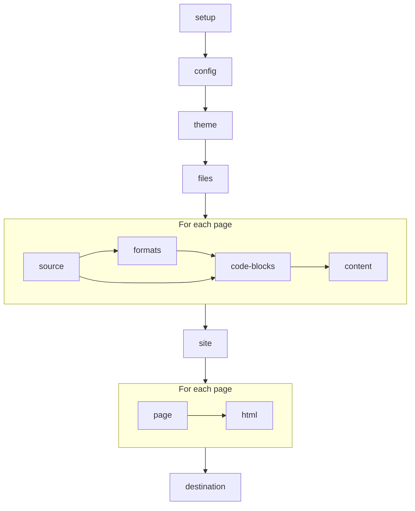

# Plugin hooks

A [plugin](../plugins/using-plugins.md) exports the hooks it needs, from
little's
[`wit/plugin.wit`](https://github.com/withlittle/little/blob/main/wit/plugin.wit),
`little:plugin@0.2.1`. little calls each as the build reaches its step,
with what the build has made so far. What the hook gives back is what the
build goes on with. [Writing plugins](../plugins/writing-plugins.md) shows
how to export one.

## The build, step by step



| Hook | Called | Given | Gives back | If it fails |
| ---- | ------ | ----- | ---------- | ----------- |
| [`setup`](#setup) | as the plugin starts | its settings | nothing | the build stops |
| [`config`](#config) | once | the site's config | the config | the build stops |
| [`theme`](#theme) | once | the theme's files | the files | the build stops |
| [`files`](#files) | once | the paths of the source's files | files to add, and to leave out | the build stops |
| [`source`](#source) | for each page | its file and text | the text | it's warned of, and the text kept |
| [`formats`](#formats) | for each page in its extensions | its file and text | the page's parts | the build stops |
| [`code-blocks`](#code-blocks) | for each block in its languages | the block | Markdown or HTML | it's warned of, and the block kept |
| [`content`](#content) | for each page | its file and HTML | the HTML | it's warned of, and the HTML kept |
| [`site`](#site) | once | `site` | `site` | the build stops |
| [`page`](#page) | for each page | `page` | `page` | it's warned of, and `page` kept |
| [`html`](#html) | for each page | its URL and HTML | the HTML | it's warned of, and the HTML kept |
| [`destination`](#destination) | once | the paths of the site's files | files to add | the build stops |

The last column says what happens when a hook
[fails](../plugins/using-plugins.md#when-a-plugin-fails).

## Every hook

little calls each hook in every plugin that exports it, in the
[order `plugins` names them](../plugins/using-plugins.md#naming-a-plugin),
in a [sandbox](../plugins/using-plugins.md#the-sandbox).

- A build starts each plugin once, so it keeps its state from hook to hook,
  and page to page. It can note each page's title in `page`, say, for a
  file it adds in `destination`.
- After a crash, the plugin starts again, with `setup`, before the next
  hook, so what it kept is lost.
- From any hook, a plugin can call `warn`, which it imports from
  `warnings`, with a line for little to
  [warn of](../plugins/using-plugins.md#when-a-plugin-fails).
- The config, `site`, and `page` are JSON objects, in strings. A file's
  contents are its bytes.

## setup

```wit
setup: func(settings: string) -> result<_, string>;
```

Called as the plugin starts, before any other hook, with its settings from
`little.yml`, as a JSON object, like `{"read":["src"],"style":"google"}`.
They don't have `wasm`, and `read` is always a list.

## config

```wit
config: func(config: string) -> result<string, string>;
```

Called once, with the site's config, as
[`little config`](commands.md#little-config) prints it. It gives back the
config the build goes on with, so it can change any setting, like
`markdown`, or add one for the theme, like `announcement`, but not `theme`,
`plugins`, `source`, `destination`, `host`, or `port`, which little reads
before plugins start.

## theme

```wit
record file { path: string, contents: list<u8> }
theme: func(files: list<file>) -> result<list<file>, string>;
```

Called once, with the files of the site's theme, layered over those of the
themes it builds on, as the build would use them, each by its path, like
`_templates/default.html`, sorted.

It gives back the files the site is built with, so it can change a
template, like adding Open Graph tags to its `<head>`, add a stylesheet, or
leave a file out. Each must be in `_templates/`, `_static/`, or `_sass/`,
as in a [theme's folder](../themes/making-a-theme.md), at a path as for
[`files`](#files), and `_templates/default.html` must stay.

## files

```wit
record file { path: string, contents: list<u8> }
record changes { add: list<file>, remove: list<string> }
files: func(paths: list<string>) -> result<changes, string>;
```

Called once, before any file is read, with the path of each file in the
source folder, from there, like `guide/install.md`, sorted, but not
[hidden](../writing/pages-and-files.md#hidden-files) ones. It gets their
paths, not what's in them: to read one, the plugin needs its folder in
[`read`](../plugins/using-plugins.md#the-sandbox).

It gives back files to `add`, and the paths of files to `remove`, which are
left out. Each file it adds is built as if it were in the source folder at
its path, as [Pages and files](../plugins/using-plugins.md#pages-and-files)
explains: a Markdown file, or one a [`formats`](#formats) hook reads, is a
page, like each module's in an [API reference](../plugins/pydoc.md), and
any other file is copied. A file that's copied, even an `.html` file,
reaches no hook after this one but `destination`.

A path is relative, with `/` between its parts. None of them is empty, `.`,
or `..`, and it has no `\` or `:`, which mean something else on Windows. A
file can be added where there's one only if the hook removes that one. As
on a disk, it can't be added where there's a folder, like `guide` beside
`guide/install.md`, or in a file, like `logo.png/small.png` beside
`logo.png`.

## source

```wit
source: func(page: string, text: string) -> result<string, string>;
```

Called for each page as it's read, with its file, from the site's folder,
like `docs/guide/install.md`, and its text: Markdown, with its frontmatter,
or the text of a file a [`formats`](#formats) hook reads, like a notebook's
JSON. It gives back the text the page is built from, frontmatter and all.
Line numbers in warnings about the page count the lines of the text it
gives back.

## formats

```wit
record code { language: string, text: string }
variant part { markdown(string), html(string), code(code) }
extensions: func() -> list<string>;
read: func(page: string, text: string, markdown: string) -> result<list<part>, string>;
```

`extensions` is called once, after `setup`, for the extensions of the files
the plugin reads, each one word, without its `.`, like `ipynb`. A file is
the plugin's by its extension, as it's written, so `ipynb` doesn't read
`.IPYNB` files. Each file in one, in the source or [added](#files), is a
page, as [Pages in other formats](../plugins/using-plugins.md#pages-in-other-formats)
explains.

`read` is called for each, as its page is read, after `source`, in place of
reading it as Markdown. It's given:

- `page`, its file, as for `source`
- `text`, its text, as `source` hooks give it back
- `markdown`, the site's
  [`markdown` settings](../writing/markdown.md#choosing-markdowns-extensions),
  as a JSON object, like `{"raw_html":true,…}`, so it can write what they
  allow

It gives back the page's parts, in order, which little writes as if they
were one Markdown file:

- `markdown`, which little writes as if the page's author had, giving its
  code blocks to [`code-blocks`](#code-blocks) hooks
- `html`, which little writes as it is, whole, and which needs
  [`raw_html`](../writing/markdown.md#choosing-markdowns-extensions)
- `code`, with its `language`, like `python`, or none, and its `text`,
  which little writes as a code block, highlighted in its language. No
  `code-blocks` hook renders it, though one in `mermaid` is still drawn,
  and one in `math` written as math.

Each `markdown` part is read on its own, so a code block it leaves open
doesn't swallow the next part. Its footnotes are numbered on from those
before, and listed at the page's end. Frontmatter, between `---` lines at
the top of the first part, is the page's.

## code-blocks

```wit
record block { language: string, info: string, text: string, page: string }
variant output { markdown(string), html(string) }
languages: func() -> list<string>;
render: func(block: block) -> result<output, string>;
```

`languages` is called once, after `setup`, for the languages the plugin
renders, each one word, like `bob`. A fenced code block is the plugin's by
its [language](../writing/code.md#languages), in any case.

`render` is called for each block in one of them, as its page is read,
after `source` and `formats`, and before its diagrams are drawn. It's
given:

- `language`, in lowercase, like `bob`
- `info`, all that's after its fence, like `bob {width=10}`
- `text`, which ends in a newline unless the block is empty
- `page`, its page's file, as for `source`

It gives back one of:

- `markdown`, which little writes as if the page's author had, as
  [Code blocks](../plugins/using-plugins.md#code-blocks) explains, but on
  its own, so it can't use the page's link reference definitions, and
  footnotes in it aren't read. Its code blocks aren't given to plugins
  again.
- `html`, which little writes as it is, and which needs
  [`raw_html`](../writing/markdown.md#choosing-markdowns-extensions)

## content

```wit
content: func(page: string, html: string) -> result<string, string>;
```

Called for each page once its Markdown is written as HTML, before it's put
in the theme, with the page's file, as for `source`, and the HTML, which
the theme gets as `page.content`. It gives back the HTML the build goes on
with, like the plugin in [Writing plugins](../plugins/writing-plugins.md),
which makes each of the page's links to other sites open in a new tab.
`page.toc` lists the headings from before the hook, so a heading it adds
isn't in it.

## site

```wit
site: func(site: string) -> result<string, string>;
```

Called once, after every page is read, with
[`site`](template-data.md#site), as the theme gets it: the config's
settings, with `nav` and `year`, and, on a site with versions, `version`
and `versions`.

It gives back the `site` the theme gets. Its `nav` must still be a list of
`{ title, url, children }`, and `page.prev`, `page.next`, and
`page.breadcrumbs` follow it, so they agree with the theme's sidebar. Its
URLs are as the theme gets them, with the path of the site's
[`url`](../getting-started/publishing.md#choosing-the-sites-url) before
them, like `/little/guide/install`, so a URL the hook adds needs it, too.
With [`nav_prune`](../writing/navigation.md#pruning-the-nav), little prunes
the nav it gives back, for each page.

## page

```wit
page: func(page: string) -> result<string, string>;
```

Called for each page, and the 404 page, before it's put in the theme, with
[`page`](template-data.md#page), as the theme gets it, with its URLs as in
`site`. It gives back the `page` the theme gets, like one with a
`reading_time` for the theme to show.

[Search](../writing/search.md) indexes the `title` and `content` it gives
back. If it has a `search`, that
[leaves the page out or keeps it in](../writing/search.md#leaving-pages-out),
as a page's frontmatter does.

## html

```wit
html: func(url: string, html: string) -> result<string, string>;
```

Called for each page the theme writes, and the 404 page, with the page's
URL, as a reader follows it, like `/little/guide/install`, and its HTML. It
gives back the HTML that's written, whose links are
[checked](../writing/links-and-images.md#checking-links), and warned of as
a reader follows them, though search doesn't see what it changes.

## destination

```wit
record file { path: string, contents: list<u8> }
destination: func(paths: list<string>) -> result<list<file>, string>;
```

Called once, after every page is put in the theme, before the site is
written, with the path of each file the build writes, from the destination,
like `guide/install/index.html`, sorted: the site's pages, its other files,
the theme's static files, and search's. It gives back files to add, like a
`sitemap.xml` or a `robots.txt`, at paths as for [`files`](#files), but not
where there's a file or a folder, or in a file.

## Versions

On a site with [versions](../writing/versions.md), the site's plugins build
the version of its files as they are. Each version from a git ref starts
them again, with
[its own settings](../writing/versions.md#a-versions-own-nav-and-plugins).
It calls each hook but `config` and `theme`, as every version is built with
the site's config and theme. Its `destination` hook sees only the files in
its own folder, with their paths from there. A warning from its plugins
names its ref:

```text
warning: plugin `pydoc` at v1.4: can't parse `mypackage/broken.py`: …
```
