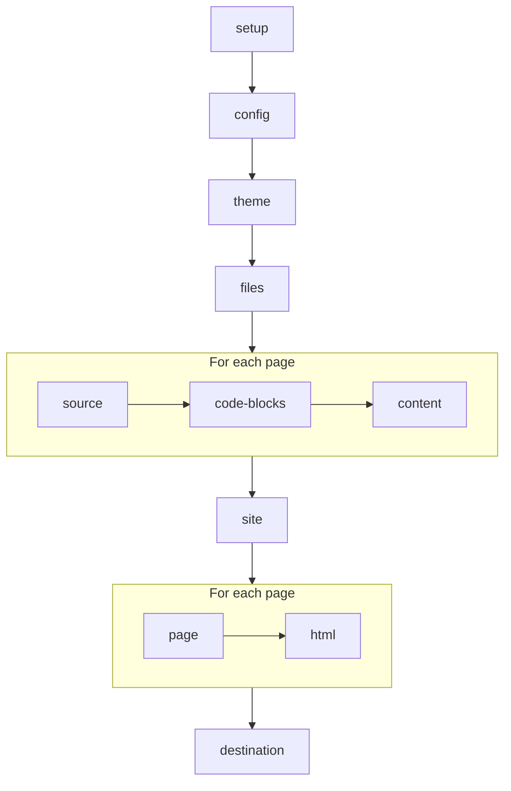

# Plugin hooks

A [plugin](../plugins/using-plugins.md) exports the hooks it needs, from
little's
[`wit/plugin.wit`](https://github.com/withlittle/little/blob/main/wit/plugin.wit),
`little:plugin@0.2.0`, and little calls each as the build reaches its step,
with what the build has made so far. What the hook gives back is what the
build goes on with. [Writing a plugin](../plugins/writing-a-plugin.md) shows
how to export one.

## The build, step by step



| Hook | Called | Given | Gives back | If it fails |
| ---- | ------ | ----- | ---------- | ----------- |
| [`setup`](#setup) | as the plugin starts | its settings | nothing | the build stops |
| [`config`](#config) | once | the site's config | the config | the build stops |
| [`theme`](#theme) | once | the theme's files | the files | the build stops |
| [`files`](#files) | once | the paths of the source's files | files to add, and to leave out | the build stops |
| [`source`](#source) | for each page | its file and text | the text | it's warned of, and the text kept |
| [`code-blocks`](#code-blocks) | for each block in its languages | the block | Markdown or HTML | it's warned of, and the block kept |
| [`content`](#content) | for each page | its file and HTML | the HTML | it's warned of, and the HTML kept |
| [`site`](#site) | once | `site` | `site` | the build stops |
| [`page`](#page) | for each page | `page` | `page` | it's warned of, and `page` kept |
| [`html`](#html) | for each page | its URL and HTML | the HTML | it's warned of, and the HTML kept |
| [`destination`](#destination) | once | the paths of the site's files | files to add | the build stops |

A hook fails when it gives back an error, or its plugin crashes, as a Rust
plugin does when it panics. One that fails on a page is warned of, naming
the plugin, the hook, and the page, and `little build --strict` fails on it:

```text
warning: plugin `links`'s `content` hook failed on ./docs/guide.md: …
```

## Every hook

- little calls each hook of each plugin that exports it in the order
  `plugins` names them, a theme's first, then the site's, each with what
  the one before gave back.
- A build starts each plugin once, so it keeps its state from hook to hook,
  and page to page: it can note each page's title in `page`, say, for a
  file it adds in `destination`. After a crash, little starts it again, and
  calls `setup`, before the next hook, so what it kept is lost.
- From any hook, a plugin can call `warn`, which it imports, with a line
  for little to warn of, naming the plugin, which `--strict` fails on:

  ```text
  warning: plugin `links`: can't read links/allowed.txt
  ```

- A plugin can read the folders its `read` names, at their paths from the
  site's folder, like `src/app.py`, and reach nothing else, as
  [the sandbox](../plugins/using-plugins.md#the-sandbox) explains.
- The config, `site`, and `page` are JSON objects, in strings, and a file's
  contents are its bytes.

## setup

```wit
setup: func(settings: string) -> result<_, string>;
```

- Called as the plugin starts, before any other hook, with its settings from
  `little.yml`, as a JSON object, without `wasm`, and with `read` always a
  list, like `{"read":["src"],"style":"google"}`.
- An error stops the build, as for a setting the plugin doesn't know.

## config

```wit
config: func(config: string) -> result<string, string>;
```

- Called once, with the site's config, as `little config` prints it: little's,
  the theme's, and the site's, merged.
- Gives back the config the build goes on with. It can change any setting,
  like `markdown`, or add one for the theme, like `announcement`, but
  `theme`, `plugins`, `source`, `destination`, `host`, and `port`, which
  little reads before plugins start.
- A change to one of those, a config little can't use, or an error, stops
  the build.

## theme

```wit
record file { path: string, contents: list<u8> }
theme: func(files: list<file>) -> result<list<file>, string>;
```

- Called once, with the files of the site's theme, layered over those of the
  themes it builds on, as the build would use them: each in `_templates/`,
  `_static/`, or `_sass/`, by its path, like `_templates/default.html`,
  sorted.
- Gives back the files the site is built with, so it can change a template,
  like adding Open Graph tags to its `<head>`, add a stylesheet, or leave a
  file out.
- Each file must be in `_templates/`, `_static/`, or `_sass/`, at a path
  as for [`files`](#files), and `_templates/default.html` must stay. One
  that isn't, two at one path, one where there's a folder or in a file, a
  Sass partial in `_static/`, or an error, stops the build.

## files

```wit
record file { path: string, contents: list<u8> }
record changes { add: list<file>, remove: list<string> }
files: func(paths: list<string>) -> result<changes, string>;
```

- Called once, before any file is read, with the path of each file in the
  source folder, but [hidden](../writing/pages-and-files.md#hidden-files) ones, from
  there, like `guide/install.md`, sorted.
- Gives back files to `add`, each built as if it were in the source folder
  at its path, so a Markdown file or a notebook is a page, and any other
  file is copied, and the paths of files to `remove`, which are left out.
  That's how an [API reference](../plugins/python-api-reference.md) adds a
  page for each module.
- A path is relative, with `/` between its parts, none of them empty, `.`,
  or `..`, and has no `\` or `:`, which mean something else on Windows.
- A file can be added where there's one only if the hook removes that one,
  and, as on a disk, not where there's a folder, like `guide` beside
  `guide/install.md`, or in a file, like `logo.png/small.png` beside
  `logo.png`.
- A path that isn't, a file that can't be there, or an error, stops the
  build.
- A page a plugin adds that would be the same page as another, like
  `guide.md` beside `guide/README.md`, stops the build, naming both, as two
  files do.
- A page a plugin adds has no file in the site's repository, so no
  `page.source_url` or `page.edit_url`, and a warning about it, like a
  broken link in it, names it as ``plugin `pydoc`'s reference/README.md``.

## source

```wit
source: func(page: string, text: string) -> result<string, string>;
```

- Called for each page as it's read, with its file, from the site's folder,
  like `docs/guide/install.md`, and its text: Markdown, with its
  frontmatter, or a notebook's JSON.
- Gives back the text the page is built from, so it can change the page's
  frontmatter, too.
- An error is warned of, and the page is built from its text as it was.

## code-blocks

```wit
record block { language: string, info: string, text: string, page: string }
variant output { markdown(string), html(string) }
languages: func() -> list<string>;
render: func(block: block) -> result<output, string>;
```

- `languages` is called once, after `setup`, for the languages the plugin
  renders, each one word, like `bob`. A fenced code block is the plugin's
  by its language, the first word after its fence, up to a comma, in any
  case. Two plugins that render one language stop the build.
- `render` is called for each block in one of them, as its page is read,
  after `source`, before its diagrams are drawn, with:
  - `language`, in lowercase, like `bob`;
  - `info`, all that's after its fence, like `bob {width=10}`;
  - `text`, which ends in a newline unless the block is empty;
  - `page`, its page's file, as for `source`.
- It gives back `markdown`, which little writes as if the page's author
  had, so its headings join the page's table of contents, its links are
  checked, its math is rendered, its diagrams drawn, and its code
  highlighted, but its blocks aren't given to plugins again; or `html`,
  which little writes as it is, and which stops the build with
  [`raw_html: false`](../writing/markdown.md#choosing-markdowns-extensions).
- An error is warned of, with the block's file and line, and the block is
  left as it was, as code:

  ```text
  warning: plugin `csv` can't render the block on line 9 of ./docs/sizes.md: the table is empty
  ```

- In a [notebook](../writing/notebooks.ipynb), the blocks in its Markdown
  cells, and in Markdown its cells showed, go to plugins too, and are
  warned of without a line. Its code cells don't.

## content

```wit
content: func(page: string, html: string) -> result<string, string>;
```

- Called for each page once its Markdown is written as HTML, before it's
  put in the theme, with its file, as for `source`, and the HTML, which the
  theme gets as `page.content`.
- Gives back the HTML the build goes on with, like the page's links to other
  sites, each opening in a new tab, as in
  [Writing a plugin](../plugins/writing-a-plugin.md).
- An error is warned of, and the HTML is kept as it was.

## site

```wit
site: func(site: string) -> result<string, string>;
```

- Called once, after every page is read, with
  [`site`](template-data.md#site), as the theme gets it: the config's
  settings, with `nav`, `year`, and, on a site with versions, `version` and
  `versions`.
- Gives back the `site` the theme gets, whose `nav` is still a list of
  `{ title, url, children }`, which `page.prev`, `page.next`, and
  `page.breadcrumbs` follow, so they agree with the theme's sidebar. A `nav`
  that isn't, or an error, stops the build.
- Its URLs are as the theme gets them, with the path of the site's
  [`url`](../getting-started/publishing.md#choosing-the-sites-url) before
  them, like `/little/guide/install`, so a URL the hook adds needs it, too.

## page

```wit
page: func(page: string) -> result<string, string>;
```

- Called for each page, and the 404 page, before it's put in the theme,
  with [`page`](template-data.md#page), as the theme gets it, its URLs as
  in `site`.
- Gives back the `page` the theme gets, like one with a `reading_time` for
  the theme to show. [Search](../writing/search.md) indexes the `title` and
  `content` it gives back.
- An error is warned of, and the theme gets `page` as it was.

## html

```wit
html: func(url: string, html: string) -> result<string, string>;
```

- Called for each page the theme writes, and the 404 page, with its URL, as
  a reader follows it, like `/little/guide/install`, and its HTML.
- Gives back the HTML that's written, whose links are
  [checked](../writing/links-and-images.md#checking-links), and warned of
  as a reader follows them. Search doesn't see what it changes.
- An error is warned of, and the HTML is written as it was.

## destination

```wit
record file { path: string, contents: list<u8> }
destination: func(paths: list<string>) -> result<list<file>, string>;
```

- Called once, after every page is put in the theme, before the site is
  written, with the path of each file it writes, from its folder in the
  destination, like `guide/install/index.html`, sorted: its pages, its other
  files, the theme's static files, and search's.
- Gives back files to add, like a `sitemap.xml` or a `robots.txt`, at paths
  as for [`files`](#files), but not where there's one, or a folder, or in a
  file.
- A path that isn't, a file that can't be there, or an error, stops the
  build, and the last build stays in the destination.

## Versions

On a site with [versions](../writing/versions.md), the site's plugins build
the version of its files as they are. Each version from a git ref starts
them again, with
[its own settings](../writing/versions.md#a-versions-own-nav-and-plugins),
and calls each hook but `config` and `theme`, as every version is built
with the site's config and theme. Its `destination` hook sees only the
files in its own folder, and a warning from its plugins names its ref:

```text
warning: plugin `pydoc` at v1.4: can't parse `mypackage/broken.py`: …
```

## Limits, for now

- `little config` prints the config before plugins change it.
- A page's line numbers, in warnings, count the lines of the text its
  `source` hooks give back.
- Headings a `content` hook adds aren't in `page.toc`.
- An `.html` file in the source isn't a page, but a file that's copied, so
  only `files` sees it.
- `files` gives a plugin the paths of the source's files, not what's in
  them: to read one, it needs its folder in `read`.
- A hook has no time limit, so one that never returns holds the build up
  until you press Ctrl-C.
