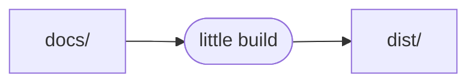
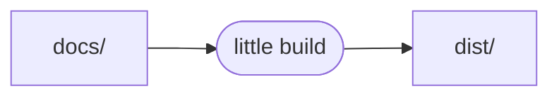
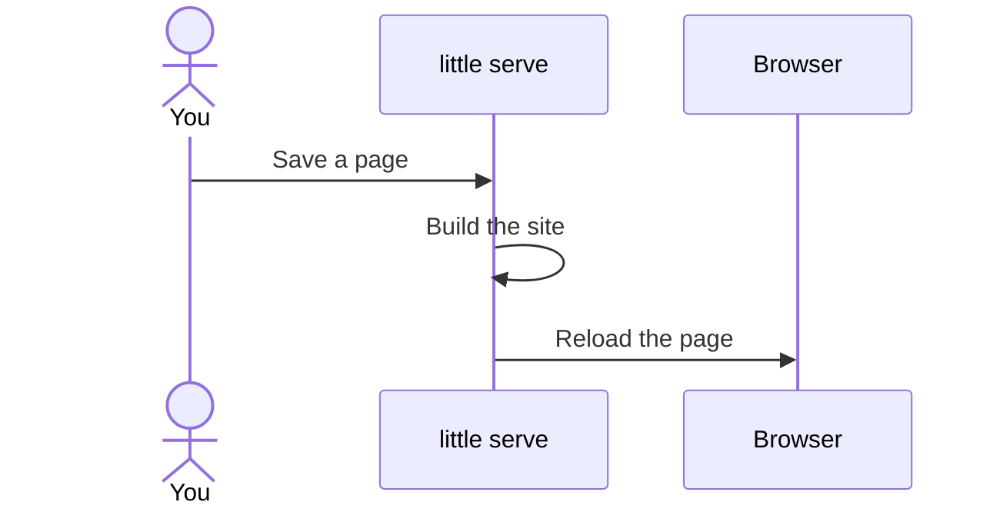

# Diagrams

Write a diagram as on GitHub, in [Mermaid](https://mermaid.js.org), in a
```` ```mermaid ```` block:

````markdown

````

little draws it as SVG as it builds the page, so browsers show it without
JavaScript:



Flowcharts, sequence diagrams, gantt charts, and more:



## Choosing how diagrams are drawn

`markdown.mermaid` chooses how a ```` ```mermaid ```` block is written:

| Value | A diagram is written… |
| ----- | --------------------- |
| `svg` | as an `<svg>`, drawn as little builds the page. little's default. |
| `false` | as code, in a `<code class="language-mermaid">`, for a theme that draws diagrams in the browser, with Mermaid's own script |

```yaml
# little.yml
markdown:
  mermaid: false
```

- little draws diagrams with [merman](https://crates.io/crates/merman), a
  port of Mermaid to Rust, which is built in. It draws flowcharts,
  sequence, class, state, and ER diagrams, gantt and pie charts, git
  graphs, mindmaps, and Mermaid's other types.
- merman isn't Mermaid's own script, so a diagram can look a little
  different than on GitHub. Mermaid's newest syntax may need a newer
  little.
- A block is Mermaid by its language: the first word after its fence, up
  to a comma, in any case, as for [code](code.md#languages).
- If little can't read a diagram, like one with a typo in its type, it
  writes it as code, as with `false`. It warns of it, with the file and
  line it's on:

  ```text
  warning: can't draw the diagram on line 12 of ./docs/guide.md: No diagram type detected
  ```

  `little build --strict` fails on one, and `little serve` warns of each
  after each build. A diagram in a page that a
  [plugin](../plugins/using-plugins.md#pages-in-other-formats) reads, like
  a notebook, is warned of without a line.
- A diagram is drawn the same in each build. A gantt chart's line at
  today's date is at the day the site was built, in UTC, or at
  [`SOURCE_DATE_EPOCH`](../themes/making-a-theme.md#a-copyright-notice). A
  diagram can turn the line off, with `todayMarker off`.
- Diagrams have Mermaid's default look, on the page's background, unless
  the theme or the site [chooses another](#choosing-how-diagrams-look).
- A diagram can carry HTML, as Markdown's HTML can. So `mermaid: svg` needs
  [`raw_html: true`](markdown.md#choosing-markdowns-extensions). With
  `raw_html: false`, every command stops until you set `mermaid: false`
  too.
- Search doesn't find the words in a diagram, and math in its labels isn't
  rendered.
- A link in a diagram, from a `click`, isn't led from the page's folder,
  or under the path of the site's
  [`url`](../getting-started/publishing.md#choosing-the-sites-url). It
  isn't [checked](links-and-images.md#checking-links) either.
- A theme that draws diagrams itself sets `false` in its `little.yml`. The
  site's `little.yml` has the last word. A page can't choose its own in its
  frontmatter.
- Anything but `svg` or `false` is an error, `true` too. Every command
  stops, and says why.

## Choosing how diagrams look

`mermaid` holds
[Mermaid's own config](https://mermaid.js.org/config/schema-docs/config.html),
in Mermaid's own names. Each diagram little draws starts from it, as if a
site passed it to `mermaid.initialize()`. little sets none, so diagrams
have Mermaid's default look.

To give diagrams your colours, start from Mermaid's `base` theme, and
[set its variables](https://mermaid.js.org/config/theming.html):

```yaml
# little.yml
mermaid:
  theme: base
  themeVariables:
    primaryColor: "#f3eefc"
    primaryBorderColor: "#6f42c1"
    lineColor: "#6f42c1"
    fontFamily: Inter, sans-serif
```

- `theme` is one of Mermaid's: `default`, `base`, `dark`, `forest`,
  `neutral`, `neo`, `neo-dark`, `redux`, `redux-dark`, `redux-color`, or
  `redux-dark-color`.
- `themeVariables` change only `base`. Mermaid works out the colours you
  don't set from those you do, so each must be hex, like `"#6f42c1"`, not
  `purple`. Put each in quotes, as YAML reads what follows a `#` as a
  comment.
- Mermaid's other settings work too, like `look: handDrawn`, `themeCSS`,
  or `flowchart: { curve: linear }`.
- A gantt chart is drawn 800 pixels wide, as little can't measure the page.
  A theme with a wider page can set `gantt: { useWidth: 1000 }`.
- A theme sets its diagrams' look in its `little.yml`. The site's
  `little.yml` has the last word, setting by setting, so a site can change
  one of its theme's colours and keep the rest. The built-in theme keeps
  Mermaid's default look.
- A diagram's own config goes over it, as in Mermaid, like
  `%%{init: {"theme": "dark"}}%%` on its first line. But a diagram's own
  `themeCSS` replaces the site's, rather than adding to it.
- A build draws each diagram in one look, so diagrams don't turn dark in
  dark mode. The built-in theme shows each on a light card, and a dark
  theme can set `theme: dark`.
- A page can't choose its diagrams' look in its frontmatter.
- little sizes each box for its label from the metrics of Mermaid's default
  font, Courier, and a generic sans-serif, as it can't see the font itself.
  So in another font, a label can fit a little loosely, or tightly.
- `mermaid` must be settings, its `theme` must be one of Mermaid's, and no
  setting can be empty. Otherwise, every command stops, and says why.
  little doesn't check the rest, so a setting Mermaid doesn't have, like
  `themeVariable`, does nothing, as in a diagram's own config.
- With [`markdown.mermaid: false`](#choosing-how-diagrams-are-drawn), little
  doesn't draw diagrams, so it ignores `mermaid`. The theme still gets it,
  as `site.mermaid`.
