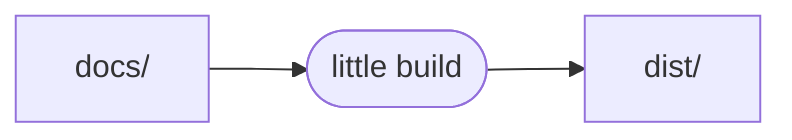
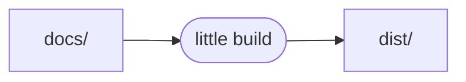
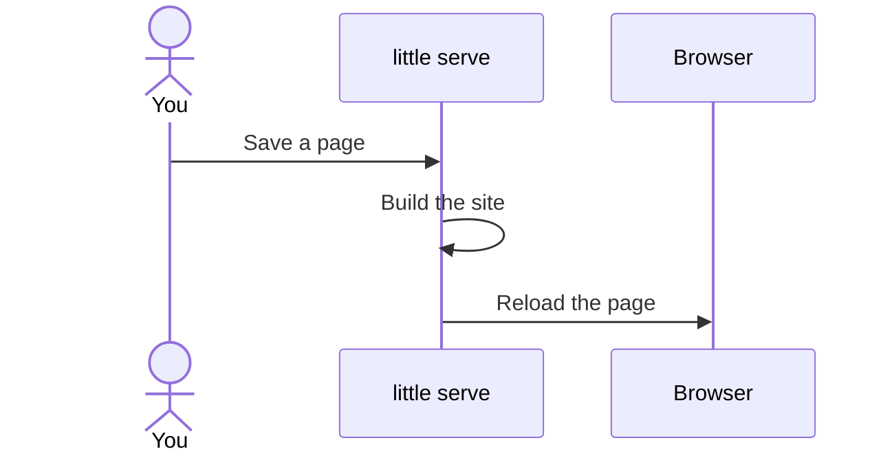

# Diagrams

Write diagrams as on GitHub, in [Mermaid](https://mermaid.js.org), in a
```` ```mermaid ```` block, and little draws each as it builds the page, as
SVG, which browsers show without JavaScript:

````markdown

````

draws



Flowcharts, sequence diagrams, gantt charts, and more:



## Choosing how diagrams are drawn

`markdown.mermaid` chooses how a ```` ```mermaid ```` block is written:

| Value | A diagram is written… |
| ----- | --------------------- |
| `svg` | as an `<svg>`, drawn as little builds the page. little's default. |
| `false` | as code, in a `<code class="language-mermaid">`, for a theme that draws diagrams in the browser, with Mermaid's own script |

```yaml
# little.yml
markdown:
  mermaid: false
```

- little draws diagrams with [merman](https://crates.io/crates/merman), a
  port of Mermaid to Rust, which is built in: flowcharts, sequence, class,
  state, and ER diagrams, gantt and pie charts, git graphs, mindmaps, and
  Mermaid's other types. It isn't Mermaid's own script, so a diagram can
  look a little different than on GitHub, and Mermaid's newest syntax may
  need a newer little.
- A block is Mermaid by its language, the first word after its fence, up to
  a comma, in any case, as for [code](code.md#languages).
- A diagram little can't read, like one with a typo in its type, is written
  as code, as with `false`, and warned of, with the file and line it's on:

  ```text
  warning: can't draw the diagram on line 12 of ./docs/guide.md: No diagram type detected
  ```

  `little build --strict` fails on one, and `little serve` warns of each
  after each build. One in a notebook is warned of without a line.
- A diagram is drawn the same in each build. A gantt chart is drawn 800
  pixels wide, unless [`mermaid`](#choosing-how-diagrams-look) says
  otherwise, and its line at today's date is at the day the site was
  built, in UTC, or at
  [`SOURCE_DATE_EPOCH`](../themes/making-a-theme.md#a-copyright-notice),
  unless the diagram turns it off, with `todayMarker off`.
- Diagrams have Mermaid's default look, on the page's background, unless
  the theme or the site [chooses another](#choosing-how-diagrams-look). A
  diagram's own config still applies to it, like
  `%%{init: {"theme": "dark"}}%%` on its first line.
- A diagram can carry HTML, as Markdown's HTML can, so `mermaid: svg` needs
  [`raw_html: true`](markdown.md#choosing-markdowns-extensions): with
  `raw_html: false`, every command stops until you set `mermaid: false` too.
- Search doesn't find the words in a diagram. A link in one, from a
  `click`, isn't led from the page's folder, or under the path of the
  site's [`url`](../getting-started/publishing.md#choosing-the-sites-url),
  and isn't [checked](links-and-images.md#checking-links). Math in its labels
  isn't rendered.
- A theme that draws diagrams itself sets `false` in its `little.yml`, and
  the site's `little.yml` has the last word. A page can't choose its own in
  its frontmatter.
- Anything but `svg` or `false` is an error, `true` too, and every command
  stops and says why.

## Choosing how diagrams look

`mermaid` holds [Mermaid's own
config](https://mermaid.js.org/config/schema-docs/config.html), in
Mermaid's own names, which each diagram little draws starts from, as a site
passes it to `mermaid.initialize()`. little sets none, so diagrams have
Mermaid's default look. To give them your colours, start from Mermaid's
`base` theme, and [set its
variables](https://mermaid.js.org/config/theming.html):

```yaml
# little.yml
mermaid:
  theme: base
  themeVariables:
    primaryColor: "#f3eefc"
    primaryBorderColor: "#6f42c1"
    lineColor: "#6f42c1"
    fontFamily: Inter, sans-serif
```

- `theme` is one of Mermaid's: `default`, `base`, `dark`, `forest`,
  `neutral`, `neo`, `neo-dark`, `redux`, `redux-dark`, `redux-color`, or
  `redux-dark-color`. `themeVariables` change only `base`, and Mermaid works
  out the colours you don't set from those you do, so each must be hex, like
  `"#6f42c1"`, not `purple`. Put each in quotes, as YAML reads what follows
  a `#` as a comment.
- Mermaid's other settings work too, like `look: handDrawn`, `themeCSS`, or
  `flowchart: { curve: linear }`. A gantt chart is drawn 800 pixels wide, as
  little can't measure the page, so a theme with a wider page can set
  `gantt: { useWidth: 1000 }`.
- A theme sets its diagrams' look in its `little.yml`, and the site's
  `little.yml` has the last word, setting by setting, so a site can change
  one of its theme's colours and keep the rest. The built-in theme keeps
  Mermaid's default look.
- A diagram's own config goes over it, like `%%{init: {"theme": "dark"}}%%`
  on its first line, as in Mermaid, but its own `themeCSS` replaces the
  site's, rather than adding to it.
- little sizes each box for its label from the metrics of Mermaid's default
  font, Courier, and a generic sans-serif, as it can't see the font itself,
  so in another font, a label can fit a little loosely, or tightly.
- A build draws each diagram in one look, so diagrams don't turn dark in
  dark mode: a dark theme can set `theme: dark`. A page can't choose its
  diagrams' look in its frontmatter.
- `mermaid` must be settings, its `theme` one of Mermaid's, and no setting
  can be empty: otherwise, every command stops and says why. little doesn't
  check the rest, so a setting Mermaid doesn't have, like `themeVariable`,
  does nothing, as in a diagram's own config.
- With [`markdown.mermaid: false`](#choosing-how-diagrams-are-drawn), little
  doesn't draw diagrams, so it ignores `mermaid`, but the theme still gets
  it, as `site.mermaid`.
