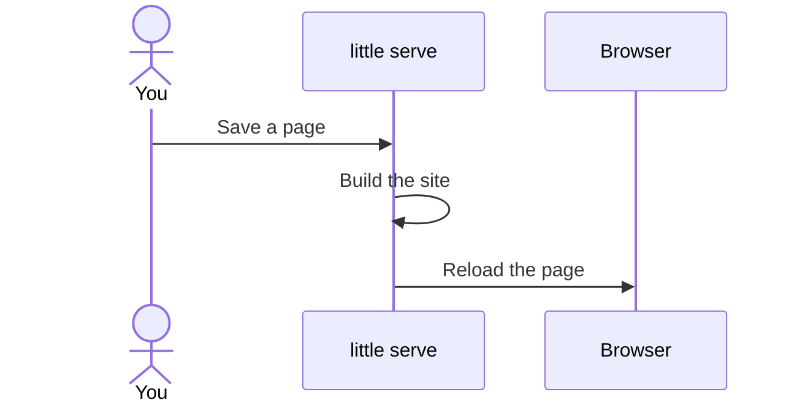

# Diagrams

Write a diagram in [Mermaid](https://mermaid.js.org), in a
```` ```mermaid ```` block:

````markdown

````

little draws it as SVG as it builds the page, so browsers show it without
JavaScript:


It draws flowcharts, sequence, class, state, and ER diagrams, gantt and pie
charts, git graphs, mindmaps, and Mermaid's other types:



A diagram can look a little different than Mermaid's own script would draw
it. If little can't read one, like one with a typo in its type, it writes
it as code, and warns of it:

```text
warning: can't draw the diagram on line 12 of ./docs/guide.md: No diagram type detected
```

A diagram is drawn the same in each build, so a gantt chart's line at
today's date is at the day the site was built, in UTC, or at
[`SOURCE_DATE_EPOCH`](../themes/making-a-theme.md#a-copyright-notice). To
leave the line out, write `todayMarker off` in the chart.

## Choosing how diagrams are drawn

`markdown.mermaid` chooses how a ```` ```mermaid ```` block is written:

```yaml
# little.yml
markdown:
  mermaid: false
```

| Value | A diagram is written… |
| ----- | --------------------- |
| `svg` | as an `<svg>`, drawn as little builds the page. little's default. |
| `false` | as a `<code class="language-mermaid">`, for Mermaid's own script to draw in the browser |

## Choosing how diagrams look

`mermaid` holds
[Mermaid's own config](https://mermaid.js.org/config/schema-docs/config.html),
the settings you'd pass to `mermaid.initialize()`, in Mermaid's own names.
Each diagram little draws starts from it. little and the built-in theme set
none, so diagrams have Mermaid's default look.

To give diagrams your colours, start from Mermaid's `base` theme, and
[set its variables](https://mermaid.js.org/config/theming.html):

```yaml
# little.yml
mermaid:
  theme: base
  themeVariables:
    primaryColor: "#f3eefc"
    primaryBorderColor: "#6f42c1"
    lineColor: "#6f42c1"
    fontFamily: Inter, sans-serif
```

- `theme` is one of Mermaid's: `default`, `base`, `dark`, `forest`,
  `neutral`, `neo`, `neo-dark`, `redux`, `redux-dark`, `redux-color`, or
  `redux-dark-color`.
- `themeVariables` change only `base`. Mermaid works out the colours you
  don't set from those you do, so each must be hex, in quotes, like
  `"#6f42c1"`, not `purple`.
- Mermaid's other settings work too, like `look: handDrawn` or
  `flowchart: { curve: linear }`.
- A gantt chart is drawn 800 pixels wide. A theme with a wider page can set
  `gantt: { useWidth: 1000 }`.
- A diagram's own config goes over it, like `%%{init: {"theme": "dark"}}%%`
  on its first line.

Each diagram is drawn in one look, so it doesn't turn dark in dark mode.
The built-in theme shows each on a light card there, and a dark theme can
set `theme: dark`.

With [`markdown.mermaid: false`](#choosing-how-diagrams-are-drawn), the
theme's script draws diagrams, and can read these settings as
`site.mermaid`.
