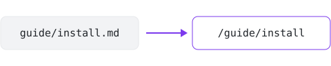

# Pages and files

Every `.md` file in `docs/` becomes a page, at a clean URL, without the
`.md`:



## Pages and URLs

```text
docs/
├── README.md           # → /
├── getting-started.md  # → /getting-started
└── guide/
    ├── README.md       # → /guide/
    ├── install.md      # → /guide/install
    └── images/
        └── setup.png   # → /guide/images/setup.png, copied as it is
```

A folder's `README.md` is the folder's own page, as on GitHub. So
`docs/README.md` is the home page.

A page's title is the `title` in its [frontmatter](frontmatter.md). Without
one, it's the page's first `#` heading, then the name of its file or
folder.

With a [plugin](../plugins/using-plugins.md#pages-in-other-formats), files
in other formats are pages too, like
[Jupyter notebooks](../plugins/jupyter-notebooks.ipynb) (`.ipynb`),
[AsciiDoc](../plugins/asciidoc.adoc) (`.adoc`),
[Org mode](../plugins/org-mode.org) (`.org`), and
[reStructuredText](../plugins/restructuredtext.rst) (`.rst`). Without the
plugin, such a file is copied, as an image is.

To build pages from a folder other than `docs/`, see
[Choosing folders](../getting-started/configuring.md#choosing-folders).

## Images and other files

Every other file in `docs/`, like an image or a PDF, is copied to the same
path in the site. So keep it beside the pages that use it, and link to it
from them, as on GitHub.

The picture above is `docs/writing/images/pretty-urls.svg`, beside this
page's file, `docs/writing/pages-and-files.md`. This page shows it with
`images/pretty-urls.svg`. See [Links and images](links-and-images.md).

- A file at the same path as one of the theme's files replaces it. So
  `docs/assets/style.css` replaces the built-in theme's stylesheet.
- Sass in `docs/` is copied as it is, like any other file. Only a theme's
  Sass is [compiled](../themes/sass.md).

## Hidden files

A file or folder whose name starts with `.` is hidden. little leaves it
out, with everything in it, like a `.drafts/` folder, or Jupyter's
`.ipynb_checkpoints/`. Saving it doesn't rebuild the site in
`little serve`.

Only names inside the source folder count. So the source folder itself can
be hidden, like `./.github`.

## Pages that clash

Two files that would be the same page stop the build, like `guide.md` and
`guide/README.md`, or `analysis.md` and an `analysis.ipynb` that a plugin
reads. The error names both:

```text
Error: docs/guide.md and docs/guide/README.md would both be the page at /guide/: rename or move one
```

On a site with [versions](versions.md), so does a page or file where
another version goes, like `docs/1.4.md` with a version at `/1.4`.

little doesn't catch pages whose URLs differ only in case, like `API.md`
and `api/README.md`. On macOS and Windows, which ignore case by default,
one replaces the other.
