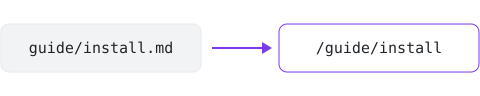

# Pages and files

Every `.md` file in `docs/` becomes a page, at a clean URL, without the
`.md`:



## Pages and URLs

```text
docs/
├── README.md           # → /
├── getting-started.md  # → /getting-started
└── guide/
    ├── README.md       # → /guide/
    ├── install.md      # → /guide/install
    └── images/
        └── setup.png   # → /guide/images/setup.png, copied as it is
```

A folder's `README.md` is the folder's own page, so `docs/README.md` is the
home page. [A page's title](frontmatter.md#a-pages-title) says what each
page is called.

With a [plugin](../plugins/using-plugins.md#pages-in-other-formats), files
in other formats are pages too, like
[Jupyter notebooks](../plugins/jupyter.ipynb) (`.ipynb`),
[AsciiDoc](../plugins/asciidoc.adoc) (`.adoc`),
[Org mode](../plugins/org-mode.org) (`.org`), and
[reStructuredText](../plugins/restructuredtext.rst) (`.rst`). Without its
plugin, such a file is copied like any other.

To build pages from a folder other than `docs/`, see
[Choosing folders](../getting-started/configuring.md#choosing-folders).

## Images and other files

Every other file in `docs/`, like an image or a PDF, is copied to the same
path in the site, so you can keep it beside the pages that use it. The
picture above is `docs/writing/images/pretty-urls.svg`, beside this page's
file, and this page shows it with `images/pretty-urls.svg`.
[Links and images](links-and-images.md) says how to link to files.

A file at the same path as one of the theme's replaces it, so
`docs/assets/style.css` replaces the built-in theme's stylesheet.

## Hidden files

little leaves out each file or folder whose name starts with `.`, with
everything in it, like a `.drafts/` folder or Jupyter's
`.ipynb_checkpoints/`, and `little serve` doesn't rebuild when you save
one. Only names inside the source folder count, so the source folder
itself can be hidden, like `./.github`.

## Redirects

When you move or rename a page, list its old URL in `redirects`, so links
to it still work:

```yaml
# little.yml
site:
  redirects:
    - to: /guide/install
      from:
        - /guide/setup
        - /setup.html
    - to: https://example.com/blog
      from:
        - /news/
```

little builds a page at each URL in `from`, which sends its reader on to
`to`, whichever host serves your site.

- `to` is a URL from the root of the site, with a `#heading` if you want
  one, or another site's address. In the site, it leads to a page or a
  file.
- `from` is a list, even of one URL. Each is from the root of the site,
  where there's no page now. `/news` and `/news/` are the same URL, and
  neither covers the URLs under it, as [a folder's](#a-folder-youve-renamed)
  does. One that ends in `.html`, as another
  tool's pages may have, is built at that file's path.

On a site with [versions](versions.md), each URL is from the root of each
version. A version has a redirect if it has the page it leads to, and no
page at its old URL, so an old version keeps its pages where they were.
little warns of a redirect that no version has.

Your theme writes each redirect's page, from its
[`redirect.html`](../themes/making-a-theme.md#redirects), as the built-in
theme does.

### A folder you've renamed

End `to` and each `from` with `/*` to redirect every page under a folder:

```yaml
# little.yml
site:
  redirects:
    - to: /tools/*
      from:
        - /widgets/*
```

Each page under `/tools/` gets a redirect from the same place under
`/widgets/`, so `/widgets/this` leads to `/tools/this`, and `/widgets/` to
`/tools/`. A page that's still under `/widgets/` stays as it is. If you
renamed a page as well, list its old URL in an entry of its own, which
goes over the folder's.
